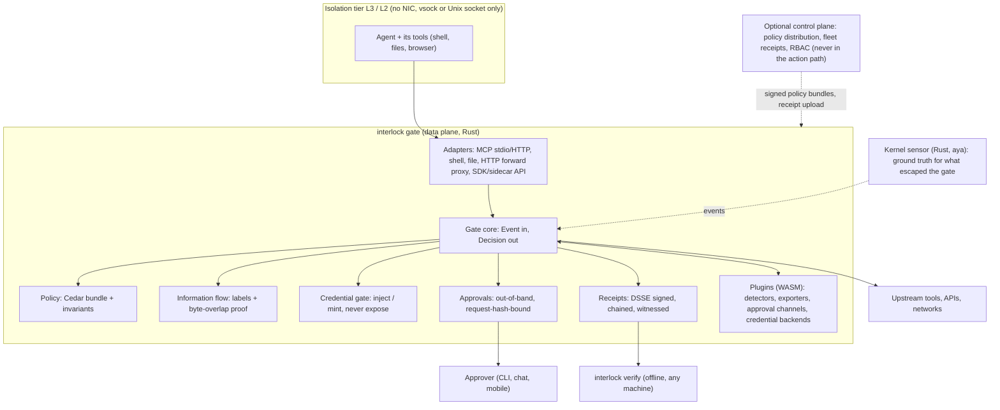

# Interlock — Roadmap

Map from *proof* to *product* — not a commitment. Priorities follow dependency and risk; integrator feedback can reorder. **Every detection feature ships with KnownGap tests naming what it does *not* catch.**

This file now spans the shipped v0.4 tool and the path to the v1.0 product. The definition of the end product (what Interlock should look like, how it plugs in, how it is customized) is in [The end product](#the-end-product). The seven fixed sections follow; new work is appended as §24 onward.

Companion SoTs (do not duplicate their prose here):

| Topic | Document |
|---|---|
| Detection gaps / tiers | [`architecture.md`](architecture.md) §13, [`INTERLOCK.md`](INTERLOCK.md) §16 |
| Boundaries / rejected | [`detection_boundary.md`](detection_boundary.md) |
| FP / CVE rates | [`fp_corpus.md`](fp_corpus.md), [`cve_corpus.md`](cve_corpus.md) |
| Privilege / deploy | [`deploy/k8s/PRIVILEGE.md`](../deploy/k8s/PRIVILEGE.md) |
| Performance | [`performance.md`](performance.md) |

---

## How to maintain this file

**Fixed sections (do not rename or reorder):**

1. Status snapshot
2. Active queue
3. Shipped ledger
4. Version history
5. Backlog (demand-gated)
6. Out of scope
7. Cross-cutting hazards

**Item schema** (use for every Active-queue and new Shipped-ledger row):

| Field | Required | Notes |
|---|---|---|
| `ID` | yes | Stable `§N` for cross-doc refs (`ROADMAP §N`). Never renumber shipped IDs. |
| `Title` | yes | Short noun phrase |
| `Status` | yes | `[ ]` open · `[~]` partial · `[x]` done · `Named` · `Rejected` |
| `Tier` | yes | 1 / 2 / 3 (see architecture §13) |
| `Goal` | yes | ≤2 sentences |
| `Done when` | yes | Testable exit criteria |
| `Links` | when shipped | Docs, tests, config knobs — not narrative |
| `WS` | phase tables | Workstream role: ISO isolation, POL policy and information flow, CRY crypto and identity, PLT platform and developer experience, ASR assurance |
| `Size` | phase tables | S under 1 engineer-week, M 2 to 3, L 4 to 6, XL 8 or more |
| `Needs` | phase tables | IDs that must land first |

**Rules:**

- Open work lives only in **Active queue** (full schema).
- Shipped work is one table row in **Shipped ledger** — detail belongs in code/docs/tests, not here.
- Do not re-open `[x]` / `Named` / `Rejected` items; file a new `§N` if scope changes.
- Do not paste corpus writeups, CVE narratives, or PR archaeology into this file.
- New work: append the next free `§N`, add to Active queue, move to Shipped ledger on merge.
- The end product definition and Appendices A to D are additions outside the seven fixed sections. Do not renumber them into the fixed list.
- Phase tables in the Active queue use one row per item with the extra columns above; `Goal` cells there may exceed two sentences. Shipped rows stay one line.

Capacity assumption: the schedule below is written for 5 principal engineers full time for about 6 to 7 months (one per workstream role). One engineer doing it alone should multiply the calendar by roughly 3 and follow the critical path in section 1.4. Months are counted from project restart (M0).

---

## The end product

Not a numbered section. This is the target the phase tables below build toward.

**Decisions closed on 2026-10-19:**

- **D1, language: full Rust rewrite approved.** The product ends as a pure Rust codebase. The rewrite follows the strangler order in Phase R (sensor, then engine, then transports), is gated by a language-neutral corpus and shadow-mode parity, and is never a big-bang cutover. New features are built only in Rust.
- **D2, license: Apache-2.0 approved.** Relicense from MIT while there is a single copyright holder (§30).

### 0.1 What v1.0 is, in one paragraph

Interlock v1.0 is an open-source, single-binary gate that sits between an AI agent and everything it can touch (MCP servers, shell, files, network, credentials), inside a sandbox that has no other way out. Every action is checked against deny-by-default policy and an information-flow rule, credentials stay in the gate and never reach the model, irreversible actions need an out-of-band human approval, and every decision is written to a signed, hash-chained receipt that a third party can verify offline. It keeps what Interlock already does best: byte-level proof that a secret left, with 0% false positives at the EXFIL tier, and an honest, tested ledger of what it cannot catch.

### 0.2 The claim it makes, and the claims it refuses to make

The product claim, version-bound and with preconditions (counsel to review before publication, see §64):

> For a session run at isolation tier L2 or L3, every action that leaves the sandbox passed through the gate, was evaluated against the loaded policy bundle, and was recorded in a signed receipt. Registered secrets that appear in outgoing payloads in a known encoding are detected and blocked.

It never claims:

| Refused claim | Why |
|---|---|
| "Prevents prompt injection" | Not solvable at the model layer. Adaptive attacks beat published defenses in the literature (Appendix A, item A6). Interlock contains the effects; it does not stop the model being persuaded. |
| "Detects all exfiltration" | Paraphrase, custom ciphers, blind inference, and other items in `detection_boundary.md` stay outside byte-overlap proof. |
| "Secure" or "safe" without a tier | Assurance depends on the isolation tier recorded in the receipt. L1 and L0 get explicit degraded labels. |
| "Verifies what the agent did" for actions outside the gate | Absence of a receipt proves nothing unless egress is enforced. The receipt records the tier so a verifier can reject unisolated runs. |

### 0.3 Architecture of the end product



Design rules that hold for every item below:

1. **The gate is the only exit.** Hooks and adapters are policy input, not the security boundary. The boundary is isolation plus egress control.
2. **Fail closed.** Gate down, policy expired, or sensor unhealthy means actions stop. Hooks that fail open are never the only control.
3. **The control plane is never in the action path.** The data plane enforces a signed, expiring policy bundle on its own.
4. **Verdict and action stay separate.** Proof (EXFIL) can block or kill. Soft signals (SUSPICIOUS) only write evidence. This is the existing, load-bearing rule.
5. **Invariants cannot be weakened by policy, packs, or plugins.** Example: the rule that a session which read untrusted and private data cannot send outbound without proof of no overlap or an approval.
6. **Every claim has a number or a KnownGap test behind it.**
7. **Memory safety by construction.** `unsafe` is forbidden outside named crates (kernel, FFI), each audited and listed.

### 0.4 Components and artifacts

| Artifact | What it is | Language |
|---|---|---|
| `interlock` | The gate: adapters, core, policy, credentials, approvals, receipts. `gate`, `proxy`, `wrap`, `init`, `doctor`, `config`, `policy`, `verify` subcommands | Rust |
| `interlock-sensor` | Kernel plane (connect, write, sendto, openat, LSM) | Rust (aya) |
| `interlock-runner` | Isolation supervisor: builds and starts L3/L2/L1 sandboxes, wires the vsock/Unix socket to the gate | Rust |
| `libinterlock-verify` | Receipt and log verifier, small and embeddable; backs `interlock verify`; also built as a C ABI and as WASM for SDK bindings | Rust |
| SDKs | Embed `Gate.check(event)` and approval hooks in an app. Rust is native; Go, TypeScript and Python are thin bindings over the sidecar protocol and the verifier | Rust, plus bindings |
| Sidecar API | Same contract over Unix socket / HTTP / gRPC with OpenAPI + protobuf | any language |
| Policy packs | Versioned, signed Cedar bundles per agent type | data |
| Plugin SDK | WASM component interface (WIT) for custom detectors, exporters, approval channels, credential backends | any language that compiles to WASM |
| Viewer | Read-only receipt viewer (exists), extended with verification status and live tailing | HTML |
| Control plane (optional) | Policy distribution, fleet receipts, RBAC, audit | Rust |
| Helm chart + operator | Kubernetes deployment, sidecar injection, `InterlockPolicy` CRD | Rust (kube-rs) + YAML |
| GitHub Action | Downloads and runs the Rust binary in CI, fails the job on missing or broken receipts | TypeScript wrapper |

### 0.5 How it behaves (runtime contract)

1. **Start.** `interlock doctor` reports the isolation tier available on this machine. `interlock wrap -- <agent command>` (or `interlock init <agent>`) starts the sandbox at the highest tier available. If the tier is below the policy's `min_tier`, it refuses to run (L0 never runs; L1 only for credential-free sessions, with a visible banner and a `degraded` flag in every receipt).
2. **Per action.** The adapter turns the action into an `Event`. The core evaluates, in order: invariants, Cedar policy (deny by default, forbid overrides permit), information-flow labels, byte-overlap proof on the payload. Result is a `Decision`: `allow`, `deny`, `ask` (approval), or `contain` (kill the process group).
3. **Credentials.** The agent holds placeholders or short-lived scoped capabilities. The gate swaps in the real credential at egress, only for allowlisted hosts and methods, and scrubs it from responses. Long-lived credentials are never handed to the agent.
4. **Approvals.** Irreversible or high-risk actions ask a human out of band. The prompt shows the effect (what will change, where, with what amount), not the agent's wording, is bound to a hash of the exact request, is single use, and high-risk classes need a second approver. Approve rate and dwell time are tracked to detect rubber-stamping.
5. **Receipt.** Every decision emits a receipt: session, sequence number, action digest, policy bundle hash, labels, verdict, action, isolation tier and attestation reference, approval reference, timestamp. Receipts are signed (DSSE), chained, and batched into a tile log that witnesses can cosign. A signed head and close receipt per session let a verifier detect truncation.
6. **Escape attempts.** The kernel sensor sees what bypassed the gate. A write containing registered secret bytes is EXFIL and contained; a bare connect outside the allowlist is recorded and, at L3, impossible because there is no network device.
7. **Stop.** Session close writes a signed close receipt. `interlock verify <file>` returns pass/fail plus the tier, policy hash, and any gaps, with no network access.

### 0.6 Easy to plug in, easy to customize (the two requirements that decide adoption)

#### Plug in: five paths, ordered from least to most effort

Target: time to first protection under 5 minutes and one command for the common cases. These are targets, not measured facts; §67 owns measuring them with real users.

| Path | For | How | Effort |
|---|---|---|---|
| 1. Wrap | Anyone running an agent from a terminal | `interlock wrap -- claude` (or any command). Starts the sandbox, points the agent at the gate | 1 command |
| 2. Init for a known agent | Claude Code, Cursor, Codex, Copilot CLI, Gemini/Antigravity, Windsurf | `interlock init claude-code` writes the hook config, managed-settings template, MCP server rewiring, fail-closed flags | 1 command + review diff |
| 3. MCP drop-in | Any MCP host | Replace a server's `command` with `interlock proxy -- <server>`; or point a remote server URL at the gate | 1 config line per server |
| 4. SDK or sidecar | Your own application or framework (LangGraph, OpenAI Agents SDK, ADK, custom) | `gate.check(event)` in-process, or HTTP/UDS/gRPC to the sidecar; conformance suite proves your adapter is correct | An afternoon |
| 5. Platform | Fleets | Helm chart, sidecar injection, `InterlockPolicy` CRD, MDM templates, GitHub Action | Platform team |

`interlock doctor` is the universal first step: it detects the platform, the tier available, the agents found, the MCP servers in use, and prints exactly which of paths 1 to 5 apply and what each would change. Nothing is modified without a diff and confirmation.

Compatibility rule: Interlock never requires changes to the agent's code for paths 1 to 3. Paths 4 and 5 are opt-in.

#### Customize: layers, from safe defaults to full control

| Layer | Mechanism | Who edits it | Guard rails |
|---|---|---|---|
| 0. Defaults | Built-in invariants and the baseline pack | Nobody | Cannot be weakened |
| 1. Profiles | `--profile coding|browser|email|ops|ci|minimal` selects a policy pack, isolation floor, and approval classes | Everyone | Packs are signed and versioned |
| 2. Config | One YAML with JSON Schema, layered: defaults < org < project < session; `interlock config lint` and `explain` | Operators | Schema-validated, secrets by reference only |
| 3. Policy | Cedar policies over tools, arguments, labels, and context; `policy test` and `policy simulate` against corpora and recorded sessions | Security engineers | `LOG_ONLY` then `ENFORCE`; invariants always evaluated first |
| 4. Tool manifest | Per-tool tags and argument schemas, auto-suggested from `tools/list`, human-confirmed, pinned and diffed | App owners | Description changes mid-session trigger a re-approval, closing the shadowing gap |
| 5. Plugins | WASM plugins for detectors, canonical-form transforms, exporters, approval channels, credential backends | Integrators | Capability-limited host API; plugins may add soft signals or extra denies, never remove a deny or an invariant |
| 6. Extension points in code | Rust crates with stable traits for transports and adapters | Contributors | Semver, conformance tests |

Customization promises: any default can be inspected (`interlock config explain`), any change can be dry-run before enforcement (`policy simulate`), and nothing a user configures can silently reduce the guarantees in the receipt, because the receipt records the policy hash, the tier, and which invariants were active.

### 0.7 Team shape (for the 5-principal assumption)

| Role | Owns | Workstream code |
|---|---|---|
| P1 Isolation and kernel | Sensor in Rust, runner, microVM/gVisor/macOS/Windows tiers, covert-channel controls | ISO |
| P2 Policy and information flow | Cedar integration, labels, taint, policy packs, simulator | POL |
| P3 Crypto, identity, receipts | Receipts, keys, attestation, witnesses, credential gate, approvals, enterprise auth | CRY |
| P4 Platform and developer experience | Gate core API, config, adapters, SDKs, plugins, init/wrap/doctor, Kubernetes, CI, docs | PLT |
| P5 Assurance and red team | Corpora, adaptive attacker, fuzzing, formal checks, supply chain, pentest/bounty, compliance, standards | ASR |

Add a full-time test and reliability engineer from M1 (strongly recommended: the rewrite and the kernel matrix make this the highest-leverage hire), plus part-time: a technical writer (from M2), a security UX designer (from M3, for approvals and `doctor`), counsel (claim wording, licensing), and external auditors (M5 onward). Design partners are a hard requirement, not a hire: see gate G1 in section 7.1.

### 0.8 Testing and robustness strategy

A security tool that is not tested harder than it tests others is a liability. The goal is not a coverage number; it is that every guarantee in section 0.2 has a test that fails when the guarantee breaks, and that the system degrades safely when something else breaks. The program is Phase T (§80 to §94) and runs continuously from M0 to GA and beyond.

**Test layers**

| Layer | What it proves | Main tools | CI tier |
|---|---|---|---|
| L0 Static | No panics or `unsafe` in the data path, vetted dependencies, no secrets in fixtures | `clippy` (pedantic plus `unwrap_used`/`expect_used`/`panic` denied in data-path crates), `cargo-deny`, `cargo-vet`, `cargo-audit`, `cargo-geiger`, gitleaks | PR |
| L1 Unit | Each function and state machine behaves as specified | `cargo test`, `cargo nextest` | PR |
| L2 Property and metamorphic | Invariants hold over huge input spaces: round-trips, monotone taint, "adding noise never removes a detection", "every one of the 13 encodings is caught" | `proptest`, `quickcheck` | PR (small), nightly (large) |
| L3 Differential | Two implementations agree: Go vs Rust engine during the port, label engine vs a reference model, Rust verifier vs an independent verifier, kernel sensor vs recorded traces | custom harnesses, replay | merge queue, nightly |
| L4 Corpus | Detection and false-positive behavior on scripted attacks and benign traffic, including held-out sets | language-neutral corpus (§75, §83) | PR (core), nightly (full) |
| L5 Integration | Components work together: proxy plus engine plus evidence plus bridge, MCP transports, spawning, netns | `cargo test` integration, golden transcripts | merge queue |
| L6 End to end | Real agents under the gate on real platforms | headless agent runs, kind, EKS and GKE, macOS, Windows, ARM | nightly |
| L7 Fuzz | No crash, hang, or OOM on hostile input to any parser | `cargo-fuzz`, AFL++, structure-aware fuzzers, OSS-Fuzz | continuous, nightly |
| L8 Kernel matrix | Probes load and behave across kernels and architectures; no loss accounting errors under saturation | QEMU or Firecracker VMs, replay traces, verifier matrix | merge queue (subset), nightly (full) |
| L9 Isolation and escape | Each tier blocks each documented escape class; covert-channel bandwidth is within the stated bound | escape suite (§86) | nightly, per release |
| L10 Chaos and crash | Failure of any part leaves the documented state; receipts survive crashes without silent gaps | fault injection, `loom`, `shuttle`, deterministic simulation, crash-point injection | weekly |
| L11 Performance, load, soak | Latency, memory and throughput stay in budget; no leaks over days | `criterion`, load generators, 72 hour soak | nightly (bench), weekly (soak) |
| L12 Compatibility and upgrade | Old configs, receipts, policies and plugins still work; latest agent and MCP versions still work | upgrade matrix, canary against upstream | nightly, per release |
| L13 Adversarial | An adaptive attacker cannot beat the stated containment | §62 harness | weekly, per release |
| L14 Usability | Real people can install, configure and approve correctly | trials, executable docs | per release |

**CI tiers**

| Tier | When | Budget | Contents |
|---|---|---|---|
| PR | every push | p90 under 15 minutes | L0, L1, small L2, core L4, build for all targets |
| Merge queue | before merge to main | under 45 minutes | L3, L5, kernel VM subset, benchmark gate |
| Nightly | every night | hours | long L2, full L4, L6, full L8, L9, long fuzz, mutation sample, canary against latest agents |
| Weekly | every week | up to 72 hours | soak, chaos, full mutation run, cross-platform escape suite, large generated corpus |
| Release qualification | each tag | days | everything above on the release candidate, upgrade matrix, reproducible-build check, red-team run |

**Proposed targets** (calibrate against the baselines produced by §29 and §88 before treating any as a gate)

| Area | Target |
|---|---|
| Core crates (engine, policy, labels, receipts, verifier) | line coverage at least 90%, branch at least 80%, mutation score at least 75% |
| Data-path crates overall | line coverage at least 80%, ratchet upward only |
| Parsers and decoders | continuous fuzzing; at least 7 days wall time per target before each minor release; zero open crashes, hangs or OOMs |
| Corpus | grows from today's 75 scenarios plus 15 CVE reconstructions to at least 1,000 curated scenarios plus generated variants (at least 100,000 per nightly run); a held-out set is never used for tuning; EXFIL-tier false positives stay at 0 on all benign sets including captured traces |
| Flaky tests | under 0.5% of runs; a flake is quarantined within 24 hours and fixed within 7 days |
| Soak | 72 hours at twice design load: memory drift under 5%, no event loss beyond the documented bound, p99.9 latency inside budget |
| Crash safety | 10,000 randomized crash points: the receipt chain still verifies and no gap is silent |
| Escape suite | 100% of documented classes blocked per tier; any newly published escape class added within 14 days |
| Compatibility | latest three versions of each supported agent and two MCP spec revisions in the nightly canary |

**Robustness principles** (enforced by §94)

- Crash-only design: any component can be killed at any instruction and recovery is the normal start path.
- No panic in the data path; panics are caught at one boundary, logged, and turn into a fail-closed decision, never a fail-open one.
- Every queue, buffer, cache, session table and recursion is bounded, with backpressure or explicit shedding and a metric for each.
- Every external call has a timeout; every retry has a budget; every degraded state has a name, a metric and a receipt flag.
- Operations are idempotent; configuration and policy are validated before use and rolled back on failure.

---

## 1. Status snapshot

| | |
|---|---|
| **Product arcs** | v0.1 proof · v0.2 usable tool · v0.3 adoptable product · v0.4 detection depth: all exit gates met |
| **Focus** | Trust repair, then platform and prevention (see version map) |
| **Language** | Go today; full Rust rewrite approved (D1), staged per Phase R |
| **Hard contracts** | EXFIL-tier FP **0.0%**; engine overhead class ~0.5 ms / ~0.1 ms must not regress, including across the rewrite; corpus verdicts identical between Go and Rust until cutover |
| **Rates (regen)** | `make fp-corpus`, `make cve-corpus` → live numbers in fp/cve corpus docs |
| **Current tag** | v0.4.0 (2026-07-30) plus Unreleased (CEF export, evidence query, entropy dark measurement, post-attach cap drop) |
| **Next arcs** | v0.5 trust repair and corpus contract, v0.6 and v0.7 Rust core and cutover, v0.8 prevention, v0.9 integration surface, v1.0-rc trust and assurance, v1.0 GA |
| **Known debt that blocks everything** | Adversarial review findings 1 to 23 (`docs/security_review.md`) are not recorded as closed in the files read for this roadmap. Confirm status first (§24 to §28). |
| **Platform reach today** | Linux x86_64 with BTF for the kernel plane; proxy plane anywhere Go compiles |
| **Open at a glance** | §21 and §23 (Named, unchanged) plus §24 to §94 in the Active queue |

### Open at a glance

| ID | Title | Status | Tier |
|---|---|---|---|
| §21 | Protocol-aware egress parsers | `Named` | 3 |
| §23 | Live evidence tailing (SSE) | `Named` | 2 |

New items §24 to §94 are listed in the phase tables of the Active queue.

### 1.1 Version map

| Version | Intent | Months |
|---|---|---|
| **v0.5** | Trust repair on the Go tree (only what cannot wait for the port), language-neutral corpus contract, Apache-2.0 relicense, governance | M0 to M1 |
| **v0.6** | Rust core, part 1: workspace, engine port, Rust sensor, and the new platform features (gate API, config v2, Cedar, labels, receipts v1) built natively in Rust | M1 to M4 |
| **v0.7** | Rust core, part 2 and cutover: proxy and transports, config, evidence, bridge, observability in Rust; shadow-mode parity; Go retired | M3 to M5 |
| **v0.8** | Prevention: isolation tiers and runners (Linux, macOS, Windows), gate-side DNS and egress controls, credential gate, approvals | M4 to M7 |
| **v0.9** | Integration surface and customization: SDKs, sidecar API, plugins, packs registry, Kubernetes operator, CI action, `init`/`wrap`/`doctor` polish | M5 to M8 |
| **v1.0-rc** | Trust and assurance: adaptive red team, fuzzing and formal checks, pentest, supply chain, compliance evidence, witnesses, standards submissions | M6 to M9 |
| **v1.0** | GA: API and schema freeze, LTS policy, upgrade tests, docs complete | M9 to M10 |
| **v1.x** | Fleet control plane, managed offering, insurer/auditor attestations, human-side kit | after GA |

Testing and robustness (Phase T) runs continuously and every version gate includes its test requirements (section 1.2).

### 1.2 Release gates (exit criteria, testable)

| Gate | Must be true |
|---|---|
| **v0.5** | Exploitable review findings fixed on the Go tree (kernel C probes, fail-open and SIGKILL paths); every other finding exists as a failing-then-pinned corpus scenario; the corpus is language-neutral data that the Go harness passes with unchanged published numbers; CI blocks regressions on EXFIL-tier FP, overhead budget and race tests; Apache-2.0 in place |
| **v0.6** | Rust engine produces identical verdict, action and `match_form` as Go on 100% of the corpus; Rust sensor replay-trace diff is empty; overhead within the existing class; Cedar policy, gate API and signed receipts v1 run in Rust with offline verification by a separate binary |
| **v0.7** | Rust proxy passes every existing integration test and demo; shadow mode shows zero unexplained diffs over the corpus and at least two weeks of replayed or design-partner traffic; Go removed from the build and release pipeline; a stranger can protect Claude Code on a laptop with `init` in under 10 minutes on Linux and macOS |
| **v0.8** | On Linux, an agent in an L3 sandbox cannot reach any network except through the gate (escape suite); credentials never appear in agent-visible memory in the test harness; approvals work end to end; macOS and Windows tiers behave as documented |
| **v0.9** | SDK conformance suite passes in all supported languages; Helm chart deploys and injects sidecars on EKS and GKE; plugin sandbox tests pass |
| **v1.0-rc** | Adaptive red team reports escape rate and taint-bypass rate with confidence intervals; independent pentest complete with all high findings fixed; SLSA Build L3 release; compliance evidence export works; receipt spec submitted |
| **v1.0** | Two or more independent production adopters; 90 days with no unfixed high-severity finding; API/schema freeze; LTS and deprecation policy published; docs and quickstarts verified by users not on the team |
| **Every release from v0.5** | PR and merge-queue tiers green; nightly fuzz shows no new unresolved crash; coverage and mutation floors not lowered; performance budget held; upgrade and compatibility matrix green; reproducible build verified; no open Sev1 or Sev2 bug; KnownGap pins unchanged or consciously flipped with the corpus numbers re-published |

### 1.3 Definition of done for every item

An item is done when: its "Done when" is met; it has unit tests, property tests where an invariant exists, at least one adversarial case and a KnownGap pin where applicable; any new parser has a fuzz target; any new failure mode has a chaos or fault-injection case and a named degraded state; `make fp-corpus`, `make cve-corpus`, the benchmark gate and (until cutover) `go test -race ./...` pass; coverage and mutation floors are not lowered; docs examples execute in CI; `config explain` text is updated; and the receipt or config schema version is bumped if the item changed either.

### 1.4 Critical path (for a smaller team)

§24 and §25 (kernel and exploitable fixes) then §75 (language-neutral corpus), then the start gate for the port (§80, §83 and §84 running on the Go tree), then §76 (engine port) then §77 (transports and evidence) then §78 (shadow mode) then §79 (cutover). In parallel and only in Rust: §31 (gate API), §33 (Cedar), §40 (receipts). Phase T starts in M0 and is not optional: §80, §83 and §84 are a hard start gate for §76, because the rewrite is only safe once the corpus is language-neutral, held-out and fuzzed. After cutover: §42, §43, §47, §49 (prevention), then §62, §65 (assurance), then §70 (freeze). The rewrite is the long pole; features that do not depend on it can slip behind it without breaking the story. If only one extra thing is possible, add §40 (signed receipts), because it is the differentiator no competitor owns.

---

## 2. Active queue

§21 stays Named until a deployment shows the MCP family.

### §21 — Protocol-aware egress parsers `Named`

| | |
|---|---|
| **Tier** | 3 |
| **Goal** | Demand-gated only: lightweight egress dissectors (git pkt-line / smart HTTP, HTTP body + `Content-Encoding`, SMTP DATA) then reuse §20 walker + overlap. |
| **Done when (documentation)** | Named boundary in ROADMAP + detection_boundary + architecture §13; CVE pin still Missed; **no engine code until demand**. |
| **Gate** | Build only if a deployment shows that MCP family in production. |
| **Links** | Pin `cve_2025_68143_mcp_git_push_wire_protocol_gap`; flat zlib/ZIP on ToolArgs/PayloadExcerpt already closed (§20). |

§23 stays Named until someone wants live monitoring over post-hoc file/CLI review.

### §23 — Live evidence tailing (SSE) `Named`

| | |
|---|---|
| **Tier** | 2 |
| **Goal** | Stream sealed `EvidenceRecord`s to `viewer.html` in real time via SSE, using the existing `EvidenceEmitObserver` hook — no new sink, no new listener, no client library. |
| **Done when (documentation)** | Named design in ROADMAP + [`live_evidence_tailing.md`](live_evidence_tailing.md); **no engine code until demand**. |
| **Gate** | Build only if a deployment wants to watch verdicts arrive live rather than reviewing files/CLI after the fact. |
| **Links** | [`live_evidence_tailing.md`](live_evidence_tailing.md) (full design + wiring sketch); hooks `engine.EvidenceEmitObserver` / `AsyncEvidenceSink.SetEmitObserver`, `internal/observability/server.go`, `web/viewer.html`. |

### Phased plan to v1.0

Phases follow the version map. Each phase table lists, per item, the required fields from the current schema (ID, Title, Status, Tier, Goal, Done when) plus WS, Size and Needs.

#### Phase 0: Trust repair (v0.5, M0 to M1)

Go-tree rule for this window: ship on Go only what cannot wait for the port (the C probes, the exploitable privilege paths, and the fail-open or crash paths). Every other finding becomes a corpus scenario first and is implemented in the Rust port (§76, §77). New features are never added to the Go tree.

Why first: the project's only asset is honest, measured claims. An open list of evadable kernel probes and a confirmed benign-input to SIGKILL path would undercut every later claim. Each fix lands as its own PR with the corpus re-run attached.

| ID | Title | Status | Tier | WS | Size | Goal | Done when | Needs |
|---|---|---|---|---|---|---|---|---|
| §24 | Kernel evasion fixes (review 1 to 6) | `[ ]` | 1 | ISO | L | Close `send(2)` blind spot, remove the `fd < 3` skip, unroll iovecs past `iov[0]`, replace the 5 s connect-to-write TTL with fd-keyed correlation, capture at `sys_exit`, zero the payload buffer and check `bpf_probe_read_user` returns Fix in the C probes first; the fixed behavior is the parity spec for the Rust sensor (§48). | Each finding has a regression test that failed before the fix; replay trace shows previously missed sends now produce EXFIL; verifier accepts on kernel 6.1 and current Ubuntu LTS; `detection_boundary.md` updated | none |
| §25 | Privilege model fixes (review 7 to 10, 19) | `[ ]` | 1 | ISO | L | Drop privileges on spawned children (uid, `NoNewPrivs`, user namespace), `openat2(RESOLVE_BENEATH|RESOLVE_NO_SYMLINKS)` in `ReadContainerFile`, cap tainted values and sessions with eviction, entropy-gate chunk minting so config divider lines cannot become EXFIL that SIGKILLs On Go ship the privilege drop and the entropy gate now; the rest is implemented in the Rust port. | Child cannot `setns` back to host netns in test; path-traversal test cannot read host files; resource-exhaustion test degrades gracefully with a metric; the benign config-divider case no longer trips | none |
| §26 | Concrete bug fixes (review 11 to 15, 18, 20, 23) | `[ ]` | 1 | PLT | M | Origin validation via `url.Parse`, non-blocking select in reader goroutine, evidence and event logs mode 0600, bridge minimum length plus hash verification, `RedactJSON` via unmarshal and remarshal, `recover()` around `IngestResult`, decode-size check on output not input, viewer escaping On Go ship only the fail-open and crash fixes (recover around ingest, file modes, origin validation, bridge checks); the rest becomes corpus scenarios implemented in Rust. | One test per finding; fuzz seed for `RedactJSON`; panic in ingest no longer fails open | none |
| §27 | Reassembly gap closure (review 16, 17) | `[ ]` | 1 | ISO | M | Parse DNS wire format correctly, join egress fragments across destinations within a session window, stop decoy flows from evicting the real one Pinned as corpus scenarios now, implemented in the Rust engine (§76). | New corpus scenarios for junk-label DNS, two-destination split, 32-decoy eviction pass; slow-trickle stays a pinned KnownGap | §24 |
| §28 | Allowlist semantics and doc accuracy (review 21, 22, Tier 4) | `[ ]` | 2 | PLT | S | Fix hostname vs IP semantics in `egress_allowlist`, stop shipping `127.0.0.1` as implicitly trusted, narrow the process-group kill or document it, correct every README or doc statement the review marked as outrunning the code | Allowlist behavior documented with tests; README claims re-audited line by line against code | none |
| §29 | Measurement harness v2 and CI gates | `[~]` | 2 | ASR | M | One command runs benchmarks, FP corpus, CVE corpus, race tests, kernel replay suite; CI fails on EXFIL-tier FP above 0, overhead regression beyond a set budget, or any pinned gap silently flipping This is the seed of Phase T; the full test program is §80 to §94. | Regression budget file in repo; dashboard of the last 30 runs; reproducible on the `deploy/ec2` Linux VM | none |
| §30 | License and governance baseline | `[~]` | 2 | PLT | S | Apache-2.0 approved (D2 closed). Relicense while there is a single copyright holder: replace `LICENSE`, add `NOTICE`, SPDX headers, README badge and text, `license` field in the Rust workspace. Adopt DCO, CODEOWNERS, trademark policy, `GOVERNANCE.md`, security policy and disclosure SLA | Apache-2.0 `LICENSE` and `NOTICE` on main; earlier MIT releases stay MIT and the change is stated in the CHANGELOG; DCO check in CI; governance doc merged | none |

#### Phase R: Rust rewrite, strangler order (v0.6 to v0.7, M1 to M5)

Order is fixed: sensor, then engine, then transports. Each stage is independently shippable and the system always works between stages. The corpus, not the Go source, is the specification. Shadow mode decides cutover.

| ID | Title | Status | Tier | WS | Size | Goal | Done when | Needs |
|---|---|---|---|---|---|---|---|---|
| §75 | Language-neutral corpus contract | `[x]` | 1 | ASR | L | Extract every scenario (FP, CVE reconstructions, malicious, benign, KnownGap pins) from `internal/corpus/scenarios_*.go` into declarative data files: event sequence, config, expected verdict, action, `match_form`, gap tag. One thin runner per language; report generators move to the runner. The corpus becomes the specification of behavior | Go harness loads every scenario and reproduces the published numbers unchanged; a stub Rust harness loads the same files; every KnownGap pin has a machine-readable tag | none |
| §48 | Rust kernel sensor (ADR 0001, stage R1) | `[ ]` | 1 | ISO | XL | Port `internal/ebpf` to aya as `interlock-sensor`, separate process, Unix socket carrying `SyscallEvent`, fixed behaviors from §24 as the parity spec | Replay-trace parity diff is empty; all root-gated tests ported; verifier accepts on pinned kernels; D1 is closed (full Rust rewrite approved); engine and transports follow as §76 and §77 | §24, §27, §75 |
| §76 | Rust workspace and engine port | `[ ]` | 1 | POL | XL | Cargo workspace with `forbid(unsafe_code)` outside named crates. Port taint registration, the 13 canonical forms, recursive decode, fragment and egress reassembly, chunk matching, container descent with the same caps, session state and leg decay, and the verdict/action classifier. Write new scenarios first for each review finding, then implement the fix in the port Start gate: the port does not begin until §80 is merged, §83 has its held-out set and generated variants running in CI, and §84 fuzzers are running against the existing Go parsers, so the Rust code is born under test. | 100% corpus parity (verdict, action, `match_form`); benchmark parity recorded for both the token path and the PEM-sized path; loom tests for shared state; `cargo-vet` clean. Compressor-form matching re-validated against output from common compressors (gzip, zlib, brotli, zstd, lz4 CLIs and libraries at several levels), because precomputed compressed forms only match byte-identical output and a port must not silently change which attacker encodings are caught | §75, §29, §80, §83, §84 |
| §77 | Rust transports, config, evidence, bridge, observability | `[ ]` | 1 | PLT | XL | MCP stdio and Streamable HTTP/SSE proxy (MCP library wrapped behind an internal trait), process spawning with PID and cgroup tracking, spawn pinning, netns sandbox, YAML config with SIGHUP reload, evidence sinks (JSONL, SQLite, hash chain with verify), taint bridge with SO_PEERCRED, Prometheus, webhooks, OCSF and CEF, vault mode | Every existing integration test and demo target passes against the Rust binary; DaemonSet runs the Rust sensor and proxy; v0.4 CLI flags and config keys work or are covered by `config migrate` | §76 |
| §78 | Shadow mode and parity gate | `[ ]` | 1 | ASR | M | Run the Go and Rust engines side by side on identical recorded and live event streams; log any verdict, action or `match_form` difference; weekly diff report | Zero unexplained diffs over the corpus and at least two weeks of replayed or design-partner traffic; every explained diff is documented as a Go bug or a Rust bug and fixed | §76, §77 |
| §79 | Cutover and Go retirement | `[ ]` | 1 | PLT | M | Make Rust the default build and publish Rust-only artifacts. Keep the last Go release as a security-fix-only branch with a stated end date. Delete the Go code, `go.mod` and cgo/BPF Go loader; update CI, Dockerfile, Makefile and docs | `go.mod` gone from main; release pipeline Rust-only; migration notes published; Go branch support end date announced | §78 |

#### Phase T: Testing and robustness (continuous, M0 to GA)

Runs in parallel with every other phase and gates every release (section 1.2). §29 (measurement harness) is its seed. Most items start in the first two months because the Rust rewrite is only safe if the tests exist first.

| ID | Title | Status | Tier | WS | Size | Goal | Done when | Needs |
|---|---|---|---|---|---|---|---|---|
| §80 | Test strategy, taxonomy and CI tiers | `[~]` | 2 | ASR | M | Adopt the layers, CI tiers and proposed targets of section 0.8; write `docs/testing.md`; define naming, ownership, flake policy, and which failures block a release | Doc merged; every existing test labelled by layer; PR tier under 15 minutes p90; targets calibrated from measured baselines | none |
| §81 | Property and metamorphic testing | `[~]` | 1 | POL | L | `proptest` suites for encodings, decode, overlap, reassembly, container descent, label propagation and policy argument canonicalization. Metamorphic relations: adding benign noise never removes an EXFIL; a secret in each of the 13 forms is always caught; splitting at any boundary within the window is caught; permuting independent events does not change the verdict | Every listed relation has a test; shrunk counterexamples become permanent regression cases; runs small in PR and large nightly | §75 |
| §82 | Differential testing | `[ ]` | 1 | ASR | L | Go vs Rust engine on identical streams during the port; Cedar-style reference model vs the label engine; second independent receipt verifier (different language) vs `libinterlock-verify`; old vs new version on recorded sessions | Harnesses run in merge queue and nightly; any disagreement fails the build or files an issue with a minimized case | §75, §76 |
| §83 | Corpus growth and held-out evaluation | `[~]` | 1 | ASR | XL | Grow the corpus beyond self-authored scenarios: mutation-generated variants (encodings, splits, padding, ordering), grammar-based tool-call generators, privacy-scrubbed captures of real benign agent traffic for false-positive measurement, a pipeline that turns each newly disclosed MCP CVE into scenarios within 14 days, contributed red-team scenarios, and a held-out set that is never used for tuning. This addresses the known weakness that a corpus written by the detector's author is close to uninformative | At least 1,000 curated scenarios; nightly generated variants; held-out detection and false-positive rates published beside the tuned ones; capture tooling redacts secrets and is reviewed | §75 |
| §84 | Continuous fuzzing infrastructure | `[~]` | 1 | ASR | L | Structure-aware fuzzers for MCP JSON-RPC and Streamable HTTP, DNS wire format, ZIP, tar, gzip, zlib, brotli, zstd and lz4 containers, YAML config, Cedar policy and bundles, receipt and log parsing, plugin ABI, and the bridge protocol. Sanitizers (ASan, UBSan, MSan where possible), saved corpora, crash triage automation, OSS-Fuzz application Starts on the existing Go parsers (Go native fuzzing) so the saved corpora carry over; each Rust target is added as its parser is ported. | Every parser has a target; nightly fuzz job reports coverage and new crashes; 7 days wall time per target before each minor; all crashes fixed and added as regressions | §75, §80 |
| §85 | Kernel and eBPF test harness | `[ ]` | 1 | ISO | XL | VM-based CI over a kernel matrix (oldest supported, 6.1, 6.6, current LTS, latest) on x86_64 and aarch64; verifier acceptance tests; replay of recorded syscall traces with diffing; ring-buffer saturation and loss-accounting tests; fault injection for failed user-memory reads; LSM deny tests; privilege-drop tests | Matrix defined and green; replay diff empty across Rust and C sensor; loss counters exact under load; unsupported kernels fail with a clear message | §24, §48 |
| §86 | Isolation and escape test suite | `[ ]` | 1 | ISO | XL | Product-level tests that assert each tier blocks each documented escape class: raw and packet sockets, io_uring, DNS, `/proc` and fd tricks, vsock misuse, shared memory and mounts, clipboard, GPU, symlink and traversal attempts, privilege re-entry; plus a measured covert-channel bandwidth bound per tier. Written as defensive assertions that the sandbox refuses, not as exploit recipes | Suite runs per tier per platform; any new public escape class is added within 14 days; every CVE class from the isolation vendors we depend on has a regression test; claims in docs match measured bounds | §43, §44, §45, §46 |
| §87 | Chaos, crash and concurrency testing | `[ ]` | 1 | ASR | L | Fault injection (kill sensor, disk full, slow or failing sinks, clock jumps, ring-buffer overflow, OOM, SIGSTOP, control-plane partition, corrupt evidence file); crash-point injection through the receipt and evidence write path; `loom` and `shuttle` for concurrency; deterministic simulation of the gate; Jepsen-style checking that no receipt gap is silent after crashes | 10,000 randomized crash points pass; every named degraded state is reached and verified; no data race found under `loom` for shared state; findings become permanent tests | §40, §52, §77 |
| §88 | Performance, load and soak testing | `[ ]` | 2 | ASR | L | `criterion` benchmarks with noise control and regression budgets; load tests far beyond the 32-session design to find real limits; 72 hour soak with memory and latency tracking; adversarial resource-exhaustion corpus (zip bombs, fat taint values, decoy flows, session floods) | Budget file in repo; p50/p99/p99.9 published per path (token-sized and PEM-sized secrets); soak shows under 5% memory drift; limits documented with the config knobs that raise them | §29 |
| §89 | End-to-end and compatibility testing | `[ ]` | 1 | PLT | XL | Headless runs of real agents (Claude Code, Cursor, Codex, Copilot CLI, Gemini/Antigravity, Windsurf) under the gate; MCP conformance suites and reference servers; golden transcripts; kind plus EKS and GKE end-to-end; macOS, Windows and Linux on x86_64 and ARM runners; nightly canary against the latest agent and MCP spec versions to catch upstream breakage before users do | Matrix green nightly; a canary failure files an issue automatically; hook fail-open or fail-closed behavior of each agent version is asserted, not assumed | §39, §55 |
| §90 | Mutation testing and coverage gates | `[ ]` | 2 | ASR | M | `cargo-mutants` on core crates, branch coverage floors with a ratchet, and an audit that every KnownGap pin still pins what it claims (a pin that can never fail is dead documentation) | Mutation score and coverage floors enforced in CI; surviving mutants triaged into new tests or documented equivalents; pin audit runs weekly | §76 |
| §91 | Executable documentation and usability trials | `[ ]` | 2 | PLT | M | Every command in quickstarts and the plug-in reference is executed in CI; `config lint` and `doctor` are fuzzed with broken inputs for error-message quality; recorded usability trials of install, `init`, approvals and policy writing | Docs that fail to run fail CI; five outside users complete the quickstart unassisted; approval-flow study measures rubber-stamping | §39, §50 |
| §92 | Release qualification and upgrade testing | `[ ]` | 1 | ASR | L | A release-candidate pipeline: full nightly and weekly suites on the exact artifact, upgrade tests from every minor since v0.6, downgrade and rollback safety, schema and golden-file compatibility for config, receipts, policies and plugins, signature and reproducible-build verification, LTS backport test runs | No tag without a green qualification run; upgrade matrix green; a deliberately broken artifact is rejected in a drill | §29, §66 |
| §93 | Test infrastructure and flake management | `[ ]` | 2 | ASR | L | Hermetic, reproducible runners; KVM-capable bare-metal or nested-virtualization workers for L3 and kernel tests; ephemeral VMs; results dashboard; flake detection with automatic quarantine and owner assignment; test-impact analysis to keep PR time down; artifact and crash-corpus retention; cost budget | Dashboard live; flake rate under 0.5%; quarantined tests have owners and deadlines; PR p90 under 15 minutes holds | §80 |
| §94 | Robustness engineering standards | `[ ]` | 1 | PLT | L | Make the principles in section 0.8 enforceable: lints denying `unwrap`, `expect`, `panic`, indexing and unchecked arithmetic in data-path crates; one catch boundary that fails closed; bounded queues with backpressure and metrics; timeouts and retry budgets on every external call; supervised restart; structured error taxonomy surfaced in receipts; `miri` and sanitizers on any crate that keeps `unsafe` | Lints enforced in CI; a code review checklist exists; every queue and cache has a bound, a metric and a test; panic-injection test proves fail-closed behavior | §76 |

#### Phase 1: Platform, built natively in Rust (v0.6 to v0.7, M1 to M5)

Goal: turn a well-tested detector into something other people can configure, embed, and extend without reading the source.

| ID | Title | Status | Tier | WS | Size | Goal | Done when | Needs |
|---|---|---|---|---|---|---|---|---|
| §31 | Gate core API | `[ ]` | 1 | PLT | L | Define the contract the whole product hangs on: `Event` in, `Decision` out, with versioned wire schemas (JSON Schema and protobuf). Built natively in Rust (`interlock-gate` crate), not in Go. MCP stdio and HTTP become adapters over this contract | Engine has no dependency on any transport; corpus runs through the public API with identical results; schema v1 published and golden-file tested | §75 |
| §32 | Config v2 | `[ ]` | 2 | PLT | M | JSON Schema for all config, layered precedence (defaults, org, project, session), secrets by reference, `config lint`, `config explain`, `config migrate`, hot reload for more keys | Every key documented from the schema; migration from v0.4 configs lossless; invalid configs fail with line-level errors | §31 |
| §33 | Cedar policy engine | `[ ]` | 1 | POL | L | Per-call, argument-aware authorization with deny by default, forbid overrides permit, policy schema generated from tool manifests, canonicalization of arguments before evaluation (Cedar has no regex or floats), policy hash in every evidence record, `LOG_ONLY` then `ENFORCE` Uses the `cedar-policy` crate directly. | A policy denies a call that tags alone would allow; hash visible in evidence; benchmark shows policy cost within the overhead budget; differential test against a reference evaluation passes | §31 |
| §34 | Tool manifests, auto-tagging, pinning | `[ ]` | 1 | POL | M | Read `tools/list`, suggest tags and argument schemas, require human confirmation, pin descriptions and schemas, diff on change and require re-approval. This removes the "mis-tagged tool is a blind spot" adoption risk and closes the runtime re-registration KnownGap | `TestToolShadowing_RuntimeReregistration_KnownGap` flips to passing; `doctor` lists untagged tools with suggested tags | §31, §33 |
| §35 | Information-flow labels, phase 1 (session level) | `[ ]` | 1 | POL | L | Add integrity (untrusted) and confidentiality (private, secret) labels computed by the gate; propagate through tool results; the lethal-trifecta rule becomes an invariant (forbid outbound when both untrusted and private were read, unless overlap check proves no registered bytes or an approval exists); declassification is a logged event | Rule fires in the corpus; benign-corpus false-positive rate for the rule is measured and published (nobody has this number yet); packs cannot weaken it | §33 |
| §36 | Policy packs v1 | `[ ]` | 1 | POL | M | Signed, versioned packs: coding agent, browser agent, email and calendar agent, ops/infra agent, CI agent, minimal read-only | Each pack ships with its tests and the corpus scenarios it is meant to stop; `--profile` selects a pack; pack signature verified at load | §33, §35, §40 |
| §37 | Policy simulator and dry-run | `[ ]` | 2 | POL | M | Replay recorded sessions and both corpora against a proposed policy or config, report blast radius (what would be blocked), diff two policies | `interlock policy simulate` prints newly denied and newly allowed actions; used in CI for pack changes | §33 |
| §38 | Laptop mode and `doctor` | `[ ]` | 2 | PLT | L | Proxy-only, no root, no Kubernetes, macOS, Linux and WSL2; L1 sandbox where available; `interlock doctor` reports tier, agents, MCP servers, gaps, and the exact commands to improve the tier | Works from a clean macOS and Ubuntu machine; refuses L0; prints honest degraded banner at L1 | §31 |
| §39 | `init` and `wrap` | `[ ]` | 2 | PLT | L | `interlock init <agent>` for Claude Code, Cursor, Codex, Copilot CLI, Gemini/Antigravity, Windsurf: writes fail-closed hooks, managed-settings templates, MCP rewiring, with a diff and confirmation. `interlock wrap -- <cmd>` for anything else | Per-agent integration test in CI; every hook is command-type and fail-closed; native sandbox stays on and Interlock sits behind it as egress proxy and credential holder | §38 |
| §40 | Receipts v1 (signed) | `[ ]` | 1 | CRY | L | DSSE-wrapped in-toto-style statements, canonical JSON, per-session sequence, signed head and close receipts, digests of arguments by default (raw only by opt-in), policy hash and tier fields, Ed25519 via a pluggable signer; keep the current hash chain readable | `interlock verify` (Rust, separate binary) detects tail truncation, gap, reorder, and forged signature in tests; schema v1 golden files; verifier works offline | §31 |
| §41 | Observability export | `[ ]` | 2 | PLT | M | OpenTelemetry traces and metrics with a pinned semantic-convention version, OCSF mapping kept, CEF kept; receipts remain the source of truth | OTel collector integration test; semconv version documented; no raw secrets in any export | §31 |

#### Phase 2: Prevention (v0.8, M4 to M7)

Goal: move from "detect and contain" to "the only exit is the gate".

| ID | Title | Status | Tier | WS | Size | Goal | Done when | Needs |
|---|---|---|---|---|---|---|---|---|
| §42 | Isolation tier model | `[ ]` | 1 | ISO | M | Define L3 (VM, no network device, vsock only), L2 (gVisor or disposable VM), L1 (process sandbox: Seatbelt, bubblewrap, Landlock plus seccomp), L0 (none). `isolation.min_tier` per profile and per capability (credentials or private data require at least L2). Tier recorded in every receipt | Behavior table implemented and tested; L0 refused with no override; L1 sessions flagged degraded | §40 |
| §43 | Linux L3 runner | `[ ]` | 1 | ISO | XL | MicroVM runner (Firecracker or Cloud Hypervisor per decision D3) with no NIC, rootfs image build, vsock to the gate, snapshot boot, per-session disposable disk, no shared mounts, no clipboard, no GPU | Escape suite: raw sockets, AF_PACKET, DNS, io_uring, `/proc` fd tricks all fail to reach any network; boot time and overhead measured on our hardware and published; the first-packet limit of Variant B is gone by construction at this tier | §42 |
| §44 | Linux L2 runner (gVisor / disposable VM) | `[ ]` | 1 | ISO | L | For hosts without nested virtualization or KVM, such as CI runners | Same escape suite passes at L2 with documented residual risk | §42 |
| §45 | macOS runner | `[ ]` | 1 | ISO | L | Apple Virtualization.framework or Apple `container` (Apple silicon, recent macOS) with vsock only; Seatbelt as L1 fallback | Escape suite adapted for macOS passes at L2/L3 where supported; unsupported hardware falls back to L1 with a banner. Primary Apple documentation for vsock and no-NIC must be confirmed first (Appendix A, A9) | §42 |
| §46 | Windows runner | `[ ]` | 1 | ISO | L | Run through WSL2 or Hyper-V with preflight (`networkingMode`, mirrored mode, DNS tunneling checks) and Hyper-V sockets; native Windows without a sandbox is refused | `doctor` detects unsafe WSL2 networking modes and offers the fix; native unsandboxed run refused with an explanation | §42 |
| §47 | Gate-side DNS and egress controls | `[ ]` | 1 | ISO | L | No resolver in the guest; the gate resolves names itself against the allowlist; DNS label count, entropy and size budgets; argument and URL size and entropy budgets; SNI and Host consistency; no shared volumes; egress canaries recorded in receipts. DNS is the live escape route in several 2025 to 2026 sandbox incidents | Covert-channel corpus (DNS tunnel, large-argument smuggling, timing) run against the tier; each channel has a measured bound or a documented residual risk; nothing claimed beyond what is measured | §43 |
| §49 | Credential gate | `[ ]` | 1 | CRY | XL | Model A (injection at the gate on allowlisted hosts and headers, placeholder swap, response scrubbing, DNS pinning) by default; Model B (short-lived scoped tokens via token exchange) where the upstream supports narrowing; never Model C (agent holds a long-lived credential). Backend plugins: cloud role sessions, secret managers. Existing `vault` mode becomes a special case | Test harness proves the model-visible context and sandbox memory never contain the real credential; wrong-host injection is denied; receipts record which credential model applied; threat model updated with the broker threats | §31, §42 |
| §50 | Out-of-band approvals | `[ ]` | 1 | CRY | L | Approvals bound to a hash of the exact request, single use, effect-first display, second approver for the highest class, channel plugins (CLI, chat, mobile push), rubber-stamp telemetry (approve rate, dwell time). Human-in-the-loop only for irreversible actions | Replay of an approved request with a changed argument is rejected; approval fatigue metrics emitted; our own usability study run before any catch-rate claim is made (Appendix A, A12) | §33, §40 |
| §51 | Enterprise identity and revocation | `[ ]` | 2 | CRY | M | Gate acts as the MCP Enterprise-Managed Authorization client, operator SSO via OIDC, OpenID Shared Signals receiver for session revocation, kill switch, per-task delegation records in receipts | IdP policy evaluated before Cedar; revocation signal terminates a live session in test | §49 |
| §52 | Fail-closed and degradation semantics v2 | `[ ]` | 1 | PLT | M | Signed expiring policy bundles, fail closed on expiry, local spool with a signed head when the control plane or exporter is down, sensor health as a gate input, explicit named degraded states | Chaos tests: kill sensor, expire bundle, fill disk, drop exporter; each yields the documented state and a receipt | §40 |
| §53 | Information-flow labels, phase 2 | `[ ]` | 1 | POL | L | Per-value labels (not only per session), field-level propagation for structured tool results, narrower declassification rules to cut false positives; semantic paraphrase scorer wired as measurement-only (never EXFIL) | False-positive rate of the invariant drops against the phase 1 baseline on the same corpus; paraphrase gap stays a pinned KnownGap | §35 |
| §54 | Non-MCP action gating | `[ ]` | 1 | PLT | L | Shell, file, and browser actions inside the sandbox are mediated: a command shim and file-access broker report to the gate; browser/computer-use agents run in a dedicated L3 profile | File and shell actions produce receipts and obey policy; native-agent tools that bypass MCP (file tools, hooks, local servers) are covered | §31, §43 |

#### Phase 3: Integration surface and customization (v0.9, M5 to M8)

Goal: the "easy to plug in, easy to customize" half of the product.

| ID | Title | Status | Tier | WS | Size | Goal | Done when | Needs |
|---|---|---|---|---|---|---|---|---|
| §55 | SDKs and sidecar API | `[ ]` | 2 | PLT | XL | Go, Rust, TypeScript and Python SDKs over the gate API: `check(event)`, `approve`, `receipt`; sidecar over Unix socket, HTTP and gRPC with OpenAPI and protobuf. All verify receipts through `libinterlock-verify` | Shared conformance suite (about 200 cases) passes in all four languages; hello-world integration in under 20 lines per language; semver and schema compatibility tests | §31, §40 |
| §56 | Plugin system (WASM) | `[ ]` | 2 | PLT | XL | WIT interface and host for custom detectors, canonical-form transforms, exporters, approval channels, credential backends. Host API is capability-limited; plugins can add soft signals or extra denies, never remove a deny, an invariant, or a receipt | Example plugin per type; a malicious plugin test (tries to allow a denied call, read credentials, open sockets) fails; plugin timeouts and memory caps enforced; wasmtime pinned with a days-level patch process | §31 |
| §57 | Kubernetes operator and Helm | `[ ]` | 2 | PLT | L | Helm chart, sidecar injection via admission webhook, `InterlockPolicy` CRD, DaemonSet sensor optional, GKE validation (EKS already validated) | One `helm install` protects a labelled namespace on EKS and GKE; policy CRD changes roll out through signed bundles | §32, §48 |
| §58 | CI integrations | `[ ]` | 2 | PLT | M | GitHub Action that runs an agent job under the gate, uploads receipts, and fails the job if the chain is missing or broken or the tier is below the floor; GitLab template | Reference workflow in the examples repo; failing-receipt case demonstrated | §40, §44 |
| §59 | Browser and computer-use profile | `Named` | 2 | ISO | L | Dedicated L3 profile with a mediated browser and clipboard policy | Build only if a design partner runs a browser agent in production | §54 |
| §60 | Managed-device deployment | `[ ]` | 2 | PLT | M | Templates and docs for MDM (Intune, Jamf), managed-settings locking of hooks, update channel via TUF | Documented, tested on a managed Mac and a managed Windows machine; users cannot disable the gate in the test | §39, §46 |
| §61 | Plugin and pack registry | `[ ]` | 3 | PLT | M | Signed index of community packs and plugins with provenance checks and a review policy | Install by name with signature verification; unreviewed packs are labelled | §36, §56 |

#### Phase 4: Trust and assurance (v1.0-rc, M6 to M9)

Goal: make every claim in section 0.2 something an outsider can check.

| ID | Title | Status | Tier | WS | Size | Goal | Done when | Needs |
|---|---|---|---|---|---|---|---|---|
| §62 | Adaptive red-team harness and "contained" metrics | `[ ]` | 1 | ASR | XL | Policy-aware adaptive attacker in CI (AutoDojo-style) plus AgentDojo and our corpora. Publish: escape rate, taint-bypass rate, utility under defense, approval burden, receipt completeness, each with confidence intervals. "Contained" gets a formal definition: for a fully attacker-controlled model, externally reachable effects equal the policy-permitted set | Definition in `docs/`; metrics reproducible with one command; static-only benchmarks are never quoted alone | §29, §43 |
| §63 | Fuzzing and formal checks | `[ ]` | 1 | ASR | L | Fuzz every parser and decoder; Cedar-style differential testing of the label engine against a reference model; Kani or Verus on the receipt verifier and chain logic; deterministic simulation tests for crash and ordering behavior Continuous fuzz infrastructure is §84; this item covers formal and differential methods. | CI fuzz budget; reference model and differential harness exist; verifier proofs or bounded model checks documented with their assumptions | §35, §40 |
| §64 | Claim review and compliance evidence | `[ ]` | 2 | ASR | L | Counsel-reviewed claim wording (version-bound, preconditions named, no "secure"), evidence export mapping receipts and approvals to EU AI Act Articles 12, 14 and 15, SOC 2 criteria, ISO 42001, NIST AI RMF; auditor engaged early | `interlock evidence export` produces a mapped bundle; marketing and README claims pass a claim checklist | §40, §50 |
| §65 | Independent assessment and bounty | `[ ]` | 1 | ASR | L | Independent pentest and code audit of the gate, sensor, runner and verifier; published results and fixes; bounty private at M4, public at GA, scope: sandbox escape, policy and taint bypass, receipt forgery, credential exposure; every fixed bypass gets a CVE or GHSA | All high findings fixed before v0.9 tag; bounty rules published; disclosure SLA met in drills | §43, §49 |
| §66 | Supply-chain assurance | `[ ]` | 1 | ASR | M | Reproducible builds (extend `reproducible_builds.md`), SLSA Build L3 and Source L3, signed releases, CycloneDX plus SPDX SBOM, `cargo-vet`, `cargo-deny`, `cargo-audit`, `cargo-geiger`, an `unsafe` allowlist, TUF-based updates, days-level patch SLA for dependencies with sandbox-relevant advisories | Release pipeline verifiable end to end by an outsider; dependency policy enforced in CI | §30 |
| §67 | Witnessing, anchoring and key management | `[ ]` | 1 | CRY | L | Tiled receipt log with at least three independent self-run C2SP witnesses (do not claim a public witness network); KMS/HSM/TPM/Secure Enclave signers; per-session keys bound to attestation report data; rotation and compromise recovery runbook; attestation reference fields for Nitro and confidential VMs | Truncation and rollback demos fail verification; key-compromise drill completed; no claim of public witnessing until a live network is confirmed | §40 |
| §68 | Standards and foundation path | `[ ]` | 2 | ASR | M | Publish the receipt and policy-context specs with conformance tests; submit to the relevant IETF/OpenSSF/LF venues; propose an MCP extension for receipts; join the foundation in the least-commitment way first (membership and working groups) and defer project submission until adopter evidence exists | Spec repo with test vectors; at least one external implementer reading the spec; no dependency on any single vendor to verify a receipt | §40 |
| §69 | Documentation and developer experience | `[ ]` | 2 | PLT | L | Quickstarts per agent and per language, `doctor` guide, deployment cookbook, adopter-facing threat model ("what this does not protect"), API reference generated from schemas, migration guides, examples repo, troubleshooting. Measure time to first protection with outside users | Five outsiders complete a quickstart without help; median time recorded and published; broken docs links and stale snippets fail CI | §39, §55 |

#### Phase 5: GA and after (v1.0, M9 to M10, then v1.x)

| ID | Title | Status | Tier | WS | Size | Goal | Done when | Needs |
|---|---|---|---|---|---|---|---|---|
| §70 | v1.0 stabilization | `[ ]` | 2 | PLT | L | Freeze public API, config, receipt, policy-context and plugin ABIs; LTS policy; deprecation windows; upgrade tests from every minor since v0.6; final claim wording | Compatibility test matrix green; two adopters in production; 90 days without an unfixed high finding | everything above in phases 0 to 4 |
| §71 | Fleet control plane | `[ ]` | 2 | PLT | XL | Optional service: signed policy bundle distribution, RBAC, operator audit log, fleet receipt storage and search, drift detection, never in the action path | Data plane keeps enforcing with the control plane down; bundle rollback works; RBAC reviewed | §52, §57 |
| §72 | Managed offering and business model | `Named` | 3 | PLT | XL | Open-core boundary: gate, sensor, runner, verifier, SDKs, packs stay open source. Paid: hosted control plane, compliance evidence and attestation tier, support, signed premium packs | Build only after at least two paying pilots; pricing not anchored to per-seat or per-agent baselines that large platform vendors already undercut | §71 |
| §73 | Third-party attestations | `Named` | 3 | ASR | M | Verifier workflow for auditors, insurers and counterparties; pilot with an affirmative-AI insurer that accepts receipts as part of its certification | Demand-gated on an insurer or bank asking for verifiable agent behavior | §67 |
| §74 | Human-side kit | `Named` | 3 | ASR | M | Procedure templates (call-back, second approver, delay for large transfers) and guidance for requiring agent receipts in contracts. Not detection software: the evidence supports procedure and liability over detection | Build only on a design partner request; no effectiveness claims without data | §73 |

---

## 3. Shipped ledger

Stable IDs for cross-doc refs (`ROADMAP §N`). One row each — no re-litigation.

### Post-corpus build order (§1–§22)

| ID | Title | Status | Tier | Done when (summary) | Links |
|---|---|---|---|---|---|
| §1 | Operational FP remediation | `[x]` | 1 | Any-trip FP down; EXFIL FP 0%; hard contain EXFIL-only | relevance-aware block, leg decay, content-bind; [`fp_corpus.md`](fp_corpus.md) |
| §2 | Close “will cover” gaps | `[x]` | 1 | Fragment buffer, fat-taint benches, payload window, extractResultText, decode depth, inherit-sink via §14 | architecture §13 |
| §3 | Variant B kernel + syscalls | `[x]` | 1 | LSM Slice 1 opt-in; writev/sendmsg; IPv6 dest | `ebpf.lsm_enforce`; Phase 2 notes below |
| §4 | Sensor↔proxy taint bridge | `[x]` | 1 | Unix-socket taint forward + SO_PEERCRED | `internal/bridge`, PRIVILEGE.md |
| §5 | Operability & enterprise | `[x]` | 2 | Fail-closed, dual ringbufs, CEF SIEM, SQLite cross-session query | `siem.format`, `Query`, `cmd/query-evidence` |
| §6 | Tamper-evident evidence | `[x]` | 1 | Hash chain + `verify-evidence` | `chain_seq` / `prev_hash` / `hash` |
| §7 | Zero-route netns (proxy) | `[x]` | 1 | `CLONE_NEWNET` opt-in; non-loopback `ENETUNREACH` | `sandbox.netns` |
| §8 | Chunk / substring match | `[x]` | 1 | Long-secret chunk EXFIL; near-chunk TN clean | `trifecta.chunk_match_*` |
| §9 | Standard compressors | `[x]` | 1 | brotli/zstd/lz4 forms; benches in class | `CanonicalEncodings` |
| §10 | Token vaulting | `[x]` | 1 | Dummy-by-default; authorize then scan | `vault.enabled` |
| §11 | Considered and rejected | `[x]` | 3 | Sockmap / SOCKS5 / unbounded trickle / blind EXFIL named | [`detection_boundary.md`](detection_boundary.md) |
| §12 | Shannon entropy (dark) | `[x]` | 2 | Measurement in fp_corpus.md; not wired | `ShannonEntropy`, `MeasureShannonEntropyDark` |
| §13 | Cap drop post-attach | `[x]` | 2 | Drop SYS_ADMIN after attach; keep KILL/BPF/PERFMON | `DropPostAttach`, PRIVILEGE.md |
| §14 | Inherit sink suspicion | `[x]` | 1 | Opt-in inherit; allowlist sole exemption | `server_defaults.inherit_sink_suspicion` |
| §15 | Configurable decode depth | `[x]` | 1 | Default 5; FP curve published | `trifecta.max_decode_depth` |
| §16 | Payload capture default 1024 | `[x]` | 2 | Default = compiled max; past-window KnownGap remains | `ebpf.payload_capture_bytes` |
| §17 | Spawn-time launch intercept | `[x]` | 1 | Pinned paths + optional allowlist | `ResolvedSpawnCommands` |
| §18 | Path-driven taint seeding | `[x]` | 1 | Whole-file container relay EXFIL | `path_taint.go` |
| §19 | Egress flow reassembly | `[x]` | 1 | Same-dest DNS/write fragments EXFIL | `SessionState.EgressFlows` |
| §20 | Bounded container descent | `[x]` | 1 | Extracted-xlsx / sink-zip / zlib EXFIL | `container.go` |
| §21 | Protocol egress parsers | `Named` | 3 | Boundary documented; no dissector | Active queue / detection_boundary |
| §22 | Blind side-channel EXFIL | `Rejected` | 3 | Not EXFIL; wrong observation model | detection_boundary; Doris CVE pin |

### v0.3 phases

| Phase | Title | Status | Notes |
|---|---|---|---|
| 1 | K8s DaemonSet (sensor-only) | `[x]` | `deploy/k8s/`; pod attribution; honest limit: full trifecta still prefers proxy+sensor |
| 2 | LSM/KRSI + graceful enforcement | `[~]` | Slice 1 shipped (`ebpf.lsm_enforce`): repeat-connect quarantine after EXFIL. First EXFIL packet stays `contained_by_kill` (architectural). Graceful per-tier responses still open. |
| 3 | Metrics, alerting, SIEM | `[x]` | Prometheus, webhooks, OCSF + CEF |
| 4 | Trust (threat model, corpus, signed release) | `[x]` | [`threat_model.md`](threat_model.md), corpora, `make release` |

### v0.2 phases

| Phase | Title | Status | Notes |
|---|---|---|---|
| 1 | HTTP/SSE transport | `[x]` | Same `InterceptedEvent` path as STDIO |
| 2 | Multi-session concurrency | `[x]` | PR #9 / #10; PID+start-time; race CI |
| 3 | Real dataflow taint | `[x]` | Encodings + eBPF write/sendto overlap → Variant B EXFIL |
| 4 | Perf + persistent evidence | `[x]` | [`performance.md`](performance.md); JSONL default, SQLite opt-in |

Tags: **`v0.2.0`** / **`v0.2.1`**.

New rows are added here as §24 onward merge, one line each.

---

## 4. Version history

Exit criteria only. Phase detail lives in the Shipped ledger.

| Version | Intent | Exit state |
|---|---|---|
| **v0.1** | Working proof | Two-plane trifecta catch; STDIO; `connect()`-only eBPF; single session; heuristic overlap; forensic receipt |
| **v0.2** | Usable tool | HTTP/SSE; concurrent sessions; encoded exfil; published overhead; persistent evidence |
| **v0.3** | Adoptable product | DaemonSet deploy; metrics/SIEM; signed release + threat model + published FP rate; LSM Slice 1 opt-in |
| **v0.4** | Detection depth | LSM Slice 1, fail-closed, dual ring buffers, hash chain, CVE corpus, definitive reference doc (shipped 2026-07-30) |
| **v0.5** | Trust repair | See release gates in section 1.2 |
| **v0.6** | Platform | See release gates in section 1.2 |
| **v0.7** | Prevention | See release gates in section 1.2 |
| **v0.8** | Integration surface | See release gates in section 1.2 |
| **v0.9** | Trust and assurance (release candidate) | See release gates in section 1.2 |
| **v1.0** | General availability | See release gates in section 1.2 |

---

## 5. Backlog (demand-gated)

Not queued until demand. Do not treat as silent “someday” execution items.

- Unix-socket and file-based exfil paths
- Role-based access and operator audit logs
- ARM support and cross-distro / CO-RE portability
- Managed cloud offering
- Third-party security audit and red-team results
- Comparison benchmarks against static scanners
- Larger compiled `PAYLOAD_MAX` / `tcp_sendmsg` pre-segmentation (beyond §16 improve-not-close)
- Graceful enforcement beyond SIGKILL (block-call / quarantine-session / alert-only per verdict) — pairs with Phase 2 residual
- GKE validation (EKS already validated)
- Protocol dissectors — only via §21 gate
- §59 browser and computer-use profile
- §72 managed offering, §73 insurer attestations, §74 human-side kit
- ARM and cross-distro CO-RE portability (needed for broad Linux fleets, queue when a design partner is on ARM)
- Per-field taint for arbitrary structured data beyond §53
- A hosted public witness network (only if a neutral operator exists; do not claim public witnessing meanwhile)
- Post-quantum co-signatures (ML-DSA as an archive co-signature) once the signing suite is stable
- Row-level or column-level data labels for database tools
- A graphical policy editor (CLI and files first; build when users ask)

---

## 6. Out of scope

Not backlog. Named so they are not reopened as features.

| Item | Why | Where |
|---|---|---|
| DoH / DoT | Mitigate with network-layer DNS controls | architecture §13 |
| Sockmap / `sk_skb` first-packet prevent | Blast-radius inversion; sync engine on SKB | §11 → detection_boundary |
| SOCKS5 egress stream scanning | Unstructured TCP + TLS MITM; wrong layer | §11 |
| Unbounded slow-trickle reassembly | Any finite window loses to slower trickle | §11; NamedGap pin |
| Blind / query-pattern EXFIL | Secret never on the wire; wrong detector | §22 |
| Protocol parsers without demand | TCB growth; Wireshark-class risk | §21 |
| Preventing or detecting prompt injection in the model | Not solvable at the model layer; the product contains effects | section 0.2 |
| Deepfake or voice detection | Evidence supports procedure and liability, not detectors | §74 |
| LLM-judged semantic exfil as an EXFIL signal | Trusts another model on the hot path, explodes false positives | `detection_boundary.md` |
| Replacing the vendor's native sandboxes | Complement them; sit behind them as egress proxy and credential holder | §39 |
| A competing credential vault product | Integrate with existing vaults through backend plugins | §49 |
| Big-bang rewrite | Stalls and hides regressions | §75 to §79 |

---

## 7. Cross-cutting hazards

| Hazard | Why it matters |
|---|---|
| **Concurrency / races** | PID reuse, namespace translation, shared-map mutation. `go test -race` is not optional. |
| **Performance vs detection depth** | Every taint/payload/session feature taxes the hot path. Benchmark continuously. |
| **Scope-infinity** | Taint and validation are bottomless. Bound with KnownGap tests. |
| **Blast-radius inversion** | In-kernel block turns bugs from “missed detection” into “broke the host.” |

Highest-risk surface remains LSM/KRSI (Phase 2): prototype on throwaway VMs; never hard-prevent on soft `SUSPICIOUS` — EXFIL-tier only (§1).

### Added hazards

| Hazard | Why it matters | Mitigation |
|---|---|---|
| **Platform absorption** | Vendors ship native sandboxes, credential masking, and managed hooks. Isolation is commoditizing | Neutrality: cross-vendor policy, byte-proof detection, gate-held credentials, and offline-verifiable receipts. Attest other runtimes instead of competing there |
| **False assurance** | A tier or claim stated too strongly is a liability and an FTC-style exposure | Version-bound claims, tier in every receipt, counsel review (§64) |
| **Approval fatigue** | Vendor data suggests humans rubber-stamp most prompts | Ask only for irreversible actions, effect-first display, second approver, telemetry (§50) |
| **Policy authoring burden** | If rules are hard to write or too noisy, people turn the product off | Packs, simulator, `LOG_ONLY`, auto-tagging, measured false-positive rate (§34, §36, §37) |
| **Rewrite risk** | A full rewrite can stall midway, silently regress detection, or freeze features for months | Strangler order, the language-neutral corpus as acceptance contract, shadow mode with zero unexplained diffs before cutover, new features only in Rust, Go limited to security fixes during the window (§75 to §79) |
| **Corpus overfitting and author bias** | A corpus written by the detector's author flatters it; tuning to it hides real misses | Held-out set never used for tuning, CVE-derived scenarios, captured benign traffic, external red-team contributions, publish held-out and tuned rates together (§83) |
| **Slow or flaky CI** | Slow feedback gets tests skipped; flakes teach people to ignore red builds | Tiered CI, flake quarantine with owners and deadlines, test-impact analysis, dedicated runners (§80, §93) |
| **Kernel, OS and agent matrix explosion** | Probes, sandboxes and hooks behave differently per kernel, OS and agent version | Explicit support matrix, VM-based kernel CI, nightly canary on latest agents, clear unsupported-platform errors (§85, §89) |
| **Standards fragmentation** | Many small receipt projects with no common format | Ship the spec with test vectors; recruit at least one external implementer (§68) |
| **Spec churn** | MCP changed materially in 2026 and will again | Wrap the MCP library behind an internal trait; support the current and previous spec eras; conformance tests per spec version |
| **Sandbox escape** | Every isolation tier had a host-impacting CVE in 2025 to 2026 | Defense in depth (guest, host firewall, no credentials in guest), disposable VMs, fast patch SLA, bounty (§65, §66) |
| **Single maintainer risk** | The project currently has one author | Governance doc, second maintainer, foundation path (§30, §68) |

### 7.1 Kill and pivot gates

| Gate | When | Test | If it fails |
|---|---|---|---|
| **G1 Design partners** | End of M2 | At least 3 design partners running real agents under the gate (wrap or init) | Stop adding surface area. Fix onboarding (§38, §39) and re-run, or narrow to the single best-fitting agent |
| **G2 Usability of the invariant** | M4 | Information-flow invariant false-positive rate and policy authoring time are acceptable to partners (they leave it on) | Downgrade the invariant to warn-by-default, keep byte-proof blocking |
| **G3 Receipt adoption** | M6 | At least one external adopter or maintainer converges on the receipt format | Pivot the receipt work to an emitter/adapter for existing brokers and gateways, or to a CI gate |
| **G4 Absorption** | continuous | A major platform ships equivalent cross-vendor enforcement plus offline-verifiable receipts | Lean on neutrality, standards and the corpora; reduce scope to the detection engine plus verifier as a library |
| **G5 Rewrite parity** | M5 | Shadow mode shows zero unexplained diffs and overhead stays in class | Do not cut over; extend the window. If the engine port cannot reach parity by M6, ship v0.7 with the Rust sensor and the new Rust features behind the Go engine over the existing Unix-socket seam (ADR 0001), and re-plan |

---

## Appendix A. Facts to confirm before relying on them

These came from research that used secondary sources or could not be confirmed. None should drive a design decision until checked against the primary source.

| # | Item | Why it matters |
|---|---|---|
| A1 | Review findings 1 to 23 in `docs/security_review.md`: current fixed or open status | Sets the exact scope of §24 to §28 |
| A2 | Indeed hiring data, Stanford/ADP revisions, other labor figures | Only used for positioning, not for design |
| A3 | EU Digital Omnibus final dates (Regulation 2026/1744, Annex III from 2 Dec 2027, Annex I from 2 Aug 2028) from a law-firm page | Drives the compliance timeline in §64 |
| A4 | gVisor CVE-2026-95702 and Kata CVE-2026-50540 details | Informs the L2 tier risk statement |
| A5 | Firecracker boot and overhead figures apply only to stated hardware; no Kata, gVisor or Apple benchmarks exist | We must benchmark ourselves (§43, §44, §45) |
| A6 | Adaptive-attack results on published prompt-injection defenses | Basis for "contained, not solved"; re-read the primary papers |
| A7 | Whether Rekor v2 witnessing has shipped, and whether any public witness network is live | Decides how witnesses are described (§67) |
| A8 | SEV-SNP and TDX attestation flows, Secure Enclave algorithm support | Decides key and attestation design (§67) |
| A9 | Apple Virtualization.framework vsock and no-NIC behavior from Apple's own docs | Decides feasibility of the macOS L2/L3 tier (§45) |
| A10 | WSL2 `networkingMode=none` and Hyper-V socket behavior | Decides the Windows tier (§46) |
| A11 | Exact MCP specification text for the revision you target, including optional authorization and enterprise-managed extensions | Decides adapter behavior (§31, §51) |
| A12 | Approval-fatigue statistics (vendor-reported) | Never quote; run our own study (§50) |
| A13 | Hook fail-open and fail-closed behavior per agent version | Decides hook configuration in `init` (§39) |
| A14 | Insurer, bank and regulator requirements for agent receipts | Demand evidence for §73 and §74 does not yet exist |
| A15 | Pricing, ACV and buyer budgets for agent security | Required before any §72 decision |
| A16 | Crate maturity and advisories (cedar-policy, rmcp, aya, rustls, wasmtime, biscuit-auth, ring) | Dependency choices in §33, §48, §56 |
| A17 | Rust crate maturity for the port: tokio, the MCP library, cedar-policy, aya, compression crates (brotli, zstd, lz4, flate2), rusqlite, kube-rs; cgroup, PID and netns APIs | Decides feasibility and effort of §76 and §77 |
| A18 | Whether precomputed compressed forms (gzip, brotli, zstd, lz4) match output from common real-world compressors, in Go today and in Rust after the port | A port could change which attacker encodings are caught; checked in §76 |
| A19 | Cost and availability of KVM-capable CI workers (bare metal or nested virtualization), and OSS-Fuzz eligibility | Decides how much of the kernel, L3 and escape suites can run on every merge (§85, §86, §93) |

## Appendix B. Decision records to close early

| ID | Decision | Options | Recommendation | Close by |
|---|---|---|---|---|
| D1 | Language boundary | Full Rust rewrite vs Rust only for kernel, runner, verifier | **Closed 2026-10-19: full Rust rewrite approved.** Strangler order: sensor, engine, transports; Go retired at cutover (§79) | closed |
| D2 | License | Stay MIT vs Apache-2.0 | **Closed 2026-10-19: Apache-2.0 approved.** Relicense now while there is a single holder (§30) | closed |
| D3 | L3 hypervisor | Firecracker vs Cloud Hypervisor vs Kata | Decide by our own benchmarks and CVE history on pinned versions; keep the runner abstract so the choice is swappable | §43 |
| D4 | Policy language | Cedar vs OPA/Rego | Cedar: formal analysis, Rust implementation, default-deny semantics; labels computed by the gate and passed in context | §33 |
| D5 | Receipt envelope | DSSE + in-toto statement with a COSE/SCITT profile vs COSE first | DSSE now (works today with existing tooling), COSE profile as an export for SCITT | §40 |
| D6 | Control plane scope | Skip entirely vs minimal | Data plane must be complete without it; ship a minimal control plane after GA | §71 |
| D7 | Registry model | Open registry vs curated | Curated, signed, review-labelled | §61 |
| D8 | Test infrastructure hosting | Self-hosted bare-metal runners vs cloud metal vs hosted CI with nested virtualization | Self-hosted or cloud bare metal for KVM and kernel tests, hosted CI for the rest; decide after measuring cost against the PR time budget | §93 |

## Appendix C. Plug-in quick reference (what the docs site will lead with)

```bash
# 1. See what you have and what tier you get
interlock doctor

# 2. Protect an agent you run from a terminal
interlock wrap -- claude

# 3. Or wire a known agent permanently (shows a diff first)
interlock init claude-code

# 4. Put one MCP server behind the gate
#    before: command: ./servers/tickets/tickets
#    after:  command: interlock proxy -- ./servers/tickets/tickets

# 5. Try a stricter policy without enforcing it
interlock policy simulate --pack coding --against ./recorded-sessions/

# 6. Check a run after the fact, on any machine, offline
interlock verify ./receipts/session-1234.dsse
```

```rust
// 7. Embed it (Rust shown; Go, TypeScript and Python are thin bindings)
let gate = interlock::Gate::builder().profile("coding").build()?;
let d = gate.check(Event::tool("send_message", args)).await?;
if d.action != Action::Allow { return Err(d.explain()); }
```

## Appendix D. Where the research maps onto this roadmap

| Research layer | Items |
|---|---|
| Rust rewrite and language-neutral corpus | §48, §75 to §79 |
| Isolation and covert channels | §42 to §47, §54 |
| Policy and information flow | §33 to §37, §53 |
| Credentials, approvals, identity | §49 to §51 |
| Receipts, keys, attestation, witnesses | §40, §52, §67 |
| Integration and distribution | §38, §39, §55 to §58, §60 |
| Testing and robustness | §29, §80 to §94 |
| Assurance and compliance | §29, §62 to §66 |
| Standards, governance, business | §30, §68, §70 to §74 |
